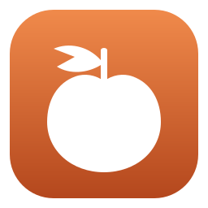
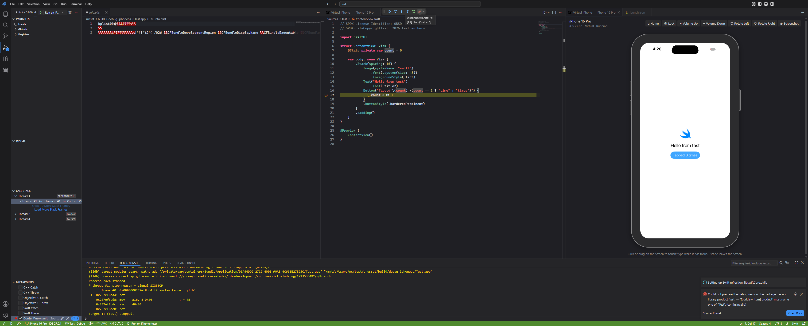
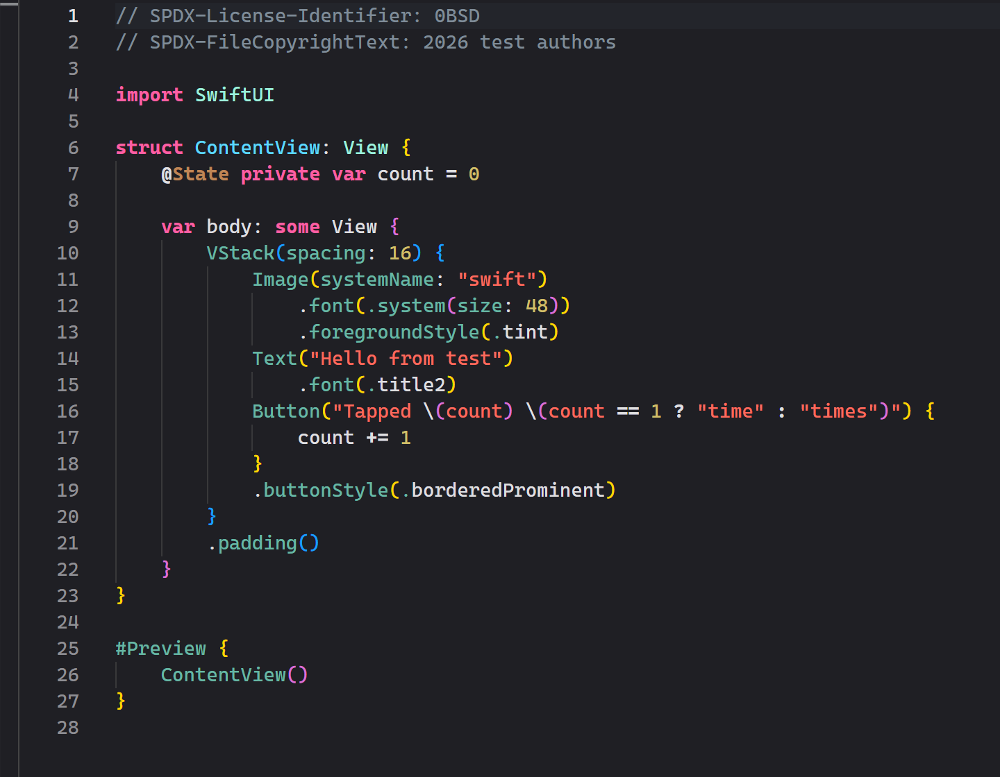
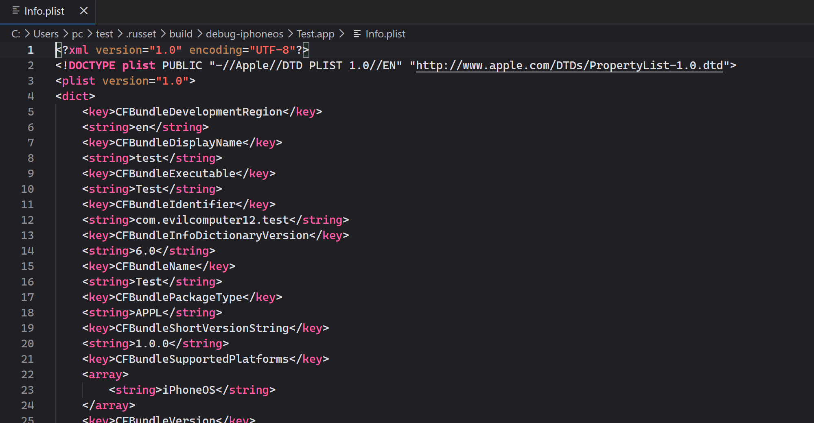
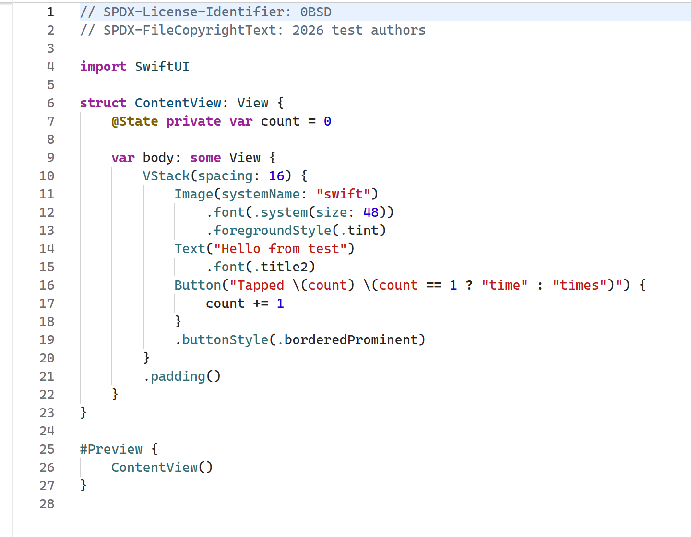
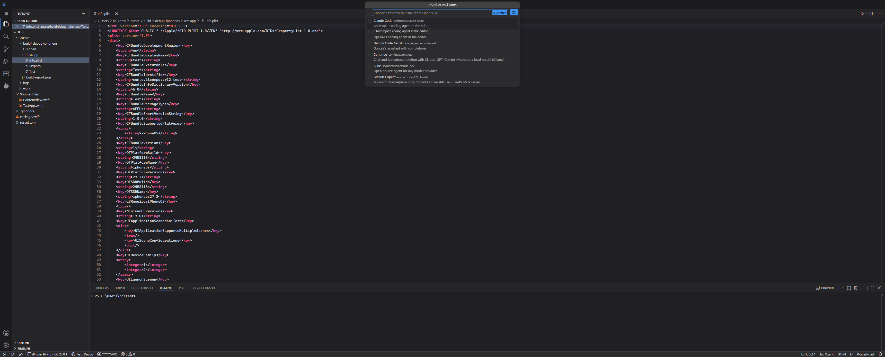

  <picture>
    <source media="(prefers-color-scheme: dark)" srcset="docs/design/brand/russet-icon-dark.svg">
    
  </picture>

# Russet

Build, run, debug and ship iOS apps from **Linux and Windows**, with a real iPhone
plugged in, and **no Mac**.

> Status: pre-alpha, developed in the open. If Russet is useful to you, star the repository and
> open an issue with what you tried: that steers what comes next.

## Russet on Windows today

A SwiftUI app built on Windows, installed on a **virtual iPhone** that runs inside the editor,
stopped at a breakpoint, with variables, step and continue:

| Xcode-style themes, light and dark | Built `Info.plist` opened as XML |
| --- | --- |
|  |  |
|  |  |

- **Virtual iPhone** (vphone-linux in WSL): its screen, touch and hardware buttons in an editor
  tab; Run installs and launches the app; Debug attaches LLDB through the phone's own debugserver.
- **Real iPhone** over USB through Apple Devices: build, install, run, live mirror, debugging.
- **Apple files**: property lists (binary ones open as XML and save back as binary),
  `.strings`, `.xcconfig`, `.pbxproj`, `.modulemap`, entitlements, provisioning profiles,
  storyboards, `.xcstrings`, Metal shaders.
- **AI**: install Claude Code, Codex, Gemini Code Assist, Continue (tab completion with any
  model) or Cline, and give them Russet's MCP tools, plus a read-only `russet-ide` server an
  agent can use to diagnose the IDE itself.
- **Self-maintaining**: the virtual iPhone engine follows upstream automatically (built beside
  the one in use, with rollback); WSL's memory and disk limits are set from the IDE.
- Not yet: Flutter on iOS (the SDK and its iOS engine files install; building waits on the Flutter
  card), and a one-click installer.

## What Russet is

- **`russet`**: a Rust command-line core and device daemon. It covers:
  - SDK import from your own Xcode download
  - builds: SwiftPM, Flutter, and later Xcode projects and React Native
  - signing with a free Apple ID or a paid App Store Connect API key
  - install, launch and LLDB debugging over USB or Wi-Fi, without root
  - logs, screen mirroring and profiling
  - TestFlight and App Store uploads
- **Russet IDE**: a desktop IDE built on Code-OSS (the open-source core of VS Code).
  - Dedicated buttons for device, run, debug and hot reload.
  - Live iPhone mirror.
  - Editors for Info.plist, signing, capabilities and assets.
  - Publishing and profiling panels.
- **Agent-ready**: a built-in MCP server lets AI agents build, run, debug, read logs,
  take screenshots and tap the screen. Supported agents: Claude Code, Codex, Gemini CLI,
  Copilot, Cline, Continue and local models.

Russet builds on open-source work: vphone-linux, vphone-cli, reims-vgpu, metal2vulkan, idevice,
xtool, apple-codesign, Code-OSS, LLVM/LLDB, Swift, Flutter and others. [CREDITS.md](CREDITS.md) names
the projects and the people and teams behind them.

## Apple software

Russet contains no Apple software and does not redistribute any. You supply your own
Xcode download (`Xcode.xip`), which you get from Apple with your own Apple ID. See
[NOTICE.md](NOTICE.md).

## License

Russet is free software under the **GNU Affero General Public License v3.0 only** (`AGPL-3.0-only`). See
[LICENSE](LICENSE).

In short: you may use, study, change and share Russet, also commercially, but anything you distribute that
contains Russet, and any modified Russet you let others use over a network, must come with its complete source
code under the same licence. Nobody can turn Russet into a closed product.

Contributions are welcome under the same licence, with a [DCO](CONTRIBUTING.md#developer-certificate-of-origin)
sign-off (`git commit -s`); there is no CLA, so contributions can never be relicensed.
